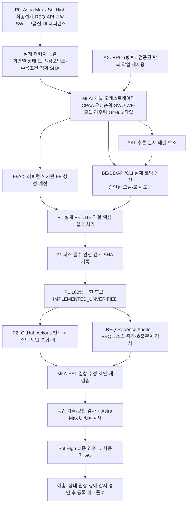

# 향후 작업 로직도(목표) — Astra 설계 → MLA·FFAX 구현 → 자동 검증
> 상태: **FUTURE_TARGET / NOT_IMPLEMENTED_AS_END_TO_END / NOT_APPROVED_FOR_AUTOMATIC_SWITCH**  
> 공시일: 2026-11-18 KST · 적용 범위: 향후 개발 운영의 목표 아키텍처 (현재 실행 정책 변경 아님)

## 0. 목적과 정본 우선순위
Plus/Codex의 Max 사용 한도와 반복 지시 비용을 줄이면서 프론트엔드 품질, BE 구현의 정확성, 독립 검수의 신뢰성을 유지한다. **최초 고품질 설계에 고성능 모델을 집중 사용하고, 이후 반복 구현·검증은 자체 제작 도구와 로컬/무료 도구로 최대한 처리**한다.

현재 효력은 `AGENTS.md`, `docs/strategy/OWNER_DEV_EXECUTION_CANONICAL_20261116.md` §0J, `docs/strategy/GPT6_HIGH_STANDARD_WORK_UNIT_20261117.md` §0E 및 각 제품 최종설계/안전 게이트에 있다. **2026년 12월 정책·모델 가용성 확인과 사용자 전환 승인 전까지 웹 GPT-6 Sol High가 P0 설계와 P1 BE/FE/DB/API/CLI 구현·국소 검사·커밋·통합을 직접 책임진다.** 이 문서는 그 책임을 즉시 MLA/Instant로 이관하지 않는다.

## 1. 목표 로직도

## 2. 역할·경계
| 담당 | 목표 책임 | 대체하지 못하는 것 |
|---|---|---|
| Astra Max / Sol High (P0) | 전체 기능 최종설계, 구조·보안·데이터 계약, UI/UX 레퍼런스, 디자인 시스템·수용조건 | 승인 주체, 실제 코드/테스트 증거 |
| MLA | SWU DAG·임계경로 선택, 코딩 모델/도구 호출, 오류 재시도, 안전한 GitHub 반영·인계 | 자체적으로 High급 추론 성능 보장 불가 |
| FFAX | 레퍼런스 분석·변형·React FE 생성, 토큰/컴포넌트 재사용, FE 자동 수정·정적/시각 검증 연계 | 미구현 기능의 자동 완성 또는 인간 심미 판단의 완전 대체 |
| EAI | 복잡한 추론·코드 수정 보조, 모델 라우팅·문제 해결 지원(구현된 계약에 한함) | 독립 감사 자격 |
| REQ Evidence Auditor | REQ·코드 증거·심볼/호출관계·누락 추적 및 보수적 판정 | 모든 취약점 탐지, 실제 기능 PASS |
| GitHub Actions | CI·빌드·타입·테스트·보안 스캔과 SHA별 결과 | 테스트가 없는 기능의 품질 보장 |
| AXZERO (향후) | 검증된 해결법·반복 절차 재사용 | 미구현 연동 또는 독립적 판단 |
| 해총 | 프로젝트별 상태·SHA·실패/장애 원장, 승인/등록 추적 | 타 제품의 P1 작업자 역할 |
| 독립 감사자 | P2 후 코드·보안·UI/UX 별도 평가 | 자기 작성 코드의 자기 검사를 독립 감사로 둔갑시키기 |

## 3. Astra 최초 설계 패키지 — FFAX 입력 계약 목표
- **설계:** REQ-ID 전수, BE/FE/DB/API·권한/원본/보안 경계, 정상·핵심 실패 경로, P1 SWU(S/C/I/D/U)·DAG·P2 수용조건.
- **시각 레퍼런스:** 화면별 데스크톱/모바일 기준, 로딩·빈 화면·오류·성공·모달 등 상태, 사용자 동선, 접근성·반응형.
- **디자인 토큰:** 색상·서체·간격·그리드·모서리·그림자·아이콘·컴포넌트 규격, 브랜드 일관성.
- **구현 계약:** 컴포넌트·라우트·폼/상태·API 요청/응답·데이터 바인딩, 레퍼런스와 결과 비교 기준.
- **증거:** 원본/라이선스·권리 검토, 설계 버전/commit SHA, 변경 이력, 미확정 사항. 레퍼런스가 불완전하면 FFAX가 복수 개선 후보를 만들되 최종 확정 권한을 임의 획득하지 않는다.

## 4. 단계별 실행과 품질 게이트
1. **P0:** 고성능 모델이 설계 패키지를 확정. 보안/데이터/권한 및 기능 범위는 사용자 승인·제품 정본 우선.
2. **P1:** MLA가 SWU 큐를 실행하고 FFAX가 FE를 구현하는 목표. 실제 caller→callee→결과와 실패 경로가 있는 소스만 구현 후보. 1 SWU는 웹 Sol High 의미 있는 실제 코딩 1회 기준을 유지. CPAA+WE, 2+2 격리/재설계/배치 이관 유지.
3. **P1 안전:** 변경부 최소 syntax/type/smoke, 인증·인가·비밀·원본·DB 손실·F18 즉시 검사, 기존 필수 CI·브랜치 보호·GO 불변. 위험 경로 HOLD, 독립 READY 계속.
4. **P2:** 구현 후보 100% 및 고유 게이트 후 전체 CI·기능·보안·통합·복구·회귀·실브라우저/실기기 검증, 결함 수정과 재검증. REQ Auditor 증거 감사와 테스트 실행은 별개.
5. **독립 검수:** Sol Max 등 실제 승인된 독립 기술·보안 감사와 Astra Max UI/UX 감사, Sol High 최종 인수. 수행하지 않은 검수는 `NOT_RUN`.
6. **사용자 GO:** main 병합, Production/환경변수/권한, 유료 호출·외부 원본 전송, 출시·크몽 등록은 각각 별도 사전 승인. 게시 URL·일자 없이는 등록완료 불가.

## 5. 모델 호출 절약 정책(목표)
- Astra Max는 **초기 고품질 디자인·레퍼런스 확정과 최종 UI/UX 독립 감사**, 예외적 고난도 문제에 우선 사용.
- Sol High는 **최초 구조·고위험 설계·최종 인수**에 집중하도록 장기적으로 전환하되, 현재 P1 직접 책임은 유지.
- MLA는 로컬/무료 모델·규칙 기반 도구를 우선 선택하고, Instant 또는 Codex 사용 시 **실제 해당 서비스 한도가 소비됨**을 기록. Qwen3-4B를 High/Max 동급이라고 가정하지 않는다.
- 동일 실패 반복 대신 실제 SHA/원인과 안전 대안을 바탕으로 수정; 불확실한 작업은 전문 모델/사용자에게 승격.
- 비용·속도·토큰·호출 감소율은 **UNMEASURED**. 60~80% 절감 등은 실측 전 공식 성과로 표기 금지.

## 6. 전환 승인 기준
- FFAX: 고정 레퍼런스 세트에서 시각 충실도·기능·반응형·접근성 결과를 독립 비교.
- MLA: SWU별 실제 BE/API/DB/FE 성공률, 재작업 횟수, SHA·테스트·권한/안전 추적.
- REQ Auditor + Actions: 검증 커버리지, 실제 FAIL 검출/수정/재검증, 허위 PASS 여부.
- 비용: 동일 프로젝트·동일 REQ·동일 환경에서 Astra/Sol Max 호출 수, 입력·출력 토큰, 총 경과시간, P1/P2 결함률을 비교.
- 실측 후 사용자에게 **전환 GO** 요청. 승인 전 `TARGET_ONLY`; 모델·정책 개편 날짜만으로 자동 전환 금지.

## 7. 상태 및 변경 범위
**이번 공시는 미래 목표 설계만 기록한다.** MLA·FFAX·EAI·AXZERO·REQ Auditor의 미완성 연동을 구현 완료로 주장하지 않는다. 구현완료율/검증완료율 변동 **0**, 제품 소스·브랜치·main·Production·GitHub App·웹훅·Actions 설정 변경 **없음**. 해총 채팅 단독 `ㄱ`은 기존 GitHub App→HMAC→Vercel→Actions→원장 임무를 계속한다.

---

## 8. GitHub 공개 프로젝트 기반 재검토 — 2026-11-18 KST

> **결정: 기존 핵심 구조 유지, 필요한 계약·검사·증거만 보강.** 새 서브시스템/신규 유료 서비스 설치·도입은 이번에 승인하거나 수행하지 않는다. 현재 MLA·EAI·FFAX·REQ Auditor의 P1/P2 완성이 우선이고, 아래는 **향후 구현 후보 백로그 / TARGET_ONLY**다. GitHub Trending은 발견 신호일 뿐 검증·보안·라이선스·성능 PASS가 아니다.

### 8A. 최우선 보강 5개

| 우선 | 개선안 / 실제 문제 | 책임 및 접점 | 완료 판정에 필요한 **미래** 증거 |
|---|---|---|---|
| 1 | **설계 ↔ 소스 수렴 게이트**: 설계가 바뀌거나 코드가 일부만 구현되어도 모델이 완료라고 말하는 문제 해결. `REQ-ID → SWU-ID → 파일/심볼 → caller→callee → 수용조건 → SHA` 매핑과 변경 영향 분석. GitHub Spec Kit의 `implement→converge`, OpenSpec의 변경 제안→구현→검증→보관 패턴만 참고 | MLA 변경 큐 + REQ Auditor 증거 엔진; 실제 P1 구현 범위는 고유 정본/승인 기준 | 고정 REQ 샘플에서 미구현/변경/누락 탐지, 허위 PASS 0, SHA 불일치 BLOCK 기록 |
| 2 | **FFAX 디자인 계약 + 실제 비교**: Astra의 레퍼런스가 이미지로만 남아 구현마다 디자인이 흔들리는 문제. 버전 고정된 `DESIGN.md` 스타일 토큰/이유, 컴포넌트/화면/상태/반응형·API 연결 계약. `lint/diff`와 렌더링 결과·스크린샷의 P2 비교, 개선 후보와 확정본 분리 | 최초 Astra/Sol High 설계 패키지 → FFAX React 생성 → P2 시각·a11y 검증 | 디자인 토큰·컴포넌트 동기화, 고정 레퍼런스의 시각 회귀·기능 PASS, 최종 사용자 승인 |
| 3 | **스킬·SOP 재사용 규격**: 매번 같은 개발 지시·인계·오류 수정 반복. `SKILL.md`(이름·목적·입출력·필요 도구·허용 경로·실패/승인 조건) + 버전·SHA·검증된 결과를 묶어 작업 시 필요한 스킬만 로드. 검증된 해결법만 AXZERO 후보로 승격 | MLA 스킬 라우팅, 해총 정책 버전 참조, 향후 AXZERO 재사용 | 같은 고정 작업에서 재현 가능하고 역효과 없는 스킬; 입력·출력·기록·권한 감사 |
| 4 | **결정론적 검사 우선, AI 검수 후행**: REQ Auditor와 CI를 혼동하지 않도록 파서/타입/빌드·CodeQL/Semgrep 계열 규칙·실제 테스트의 기계 판정 → AI 진단/수정 제안 → 재실행. Alibaba OpenCodeReview의 hybrid 패턴만 참고 | GitHub Actions + REQ Auditor + MLA/EAI(수정) | FAIL이 실제 수정 후 PASS로 전환된 SHA와 로그, 미실행=NOT_RUN, 독립 감사 별도 |
| 5 | **실측 기반 모델 라우팅·비용 게이트**: 막연히 Instant/로컬/Max가 싸거나 빠르다고 가정하지 않음. 동일 REQ·SWU·기준 SHA·데이터에서 성공률/결함·재작업·경과시간·입출력·캐시·추론(가용시) 토큰/크레딧·사용 한도를 측정한 뒤 선택 | MLA 기록 → 해총 원장 집계; 사용자 승인 모델만 라우팅 | 골든 태스크 비교 결과 및 비용·품질 변화, 불명 수치 UNMEASURED; 자동 유료 승격 금지 |

### 8B. 기존 로직도 수정 필요 지점(현재 문서 해석에 적용)

1. **P0 설계 동결과 변경 제어**: 확정 설계 패키지마다 `design_sha`, `target_repo_sha`, `req_ids`, `swu_ids`, `acceptance_version`, `allowed_paths`, `risk_gates`를 갖는 매니페스트를 목표로 한다. 이후 변경은 명시적 delta·영향 SWU/테스트만 재계산; 확정 기능·권한·보안 범위는 사용자/정본 승인 없이 묵시 축소하지 않는다.
2. **MLA는 오케스트레이터이지 지능 대체물이 아님**: 로컬 Qwen3-4B·Instant·외부 모델에 각각 실패/품질/한도와 호출 비용이 있다. 모델 라우팅은 실제 사용 가능한 승인 모델과 실측 근거에만 의존. 실패 2+2·필수 차단 즉시 제품 실작업자 승격 및 모델 가용성 표기 유지.
3. **FFAX의 범위 경계**: 레퍼런스 기반 **React/Web FE** 생산을 우선한다. EAI 등 Windows 네이티브 EXE UI까지 FFAX가 자동 생성·검증한다고 주장하지 않는다. 네이티브 UI에는 디자인 토큰/화면 명세를 공유하되 **플랫폼별 별도 구현기·실기기 P2 증거**가 필요하다.
4. **검수의 독립성**: `REQ Auditor 근거 찾기`, `Actions 테스트 PASS`, `MLA 자체 수정/재검증`, `Sol Max 독립 코드·보안 감사`, `Astra 독립 UI/UX 감사`, `High 최종 인수`, `사용자 운영 GO`는 서로 다른 상태다. 스스로 작성한 코드를 스스로 돌린 것을 독립 감사로 승격 금지.
5. **격리 실행과 커밋 안전**: 미래 MLA 자동 개발은 리포/브랜치/기준 SHA·허용 경로별 격리 작업공간, 최소 권한, diff 선검토, 비충돌 순차 통합, 복구 가능 체크포인트를 전제한다. LoopForge의 샌드박스·SOP·human gate 설계를 참고하되 Docker 설치나 로컬 VRAM/RAM 비용 증가를 요구하지 않는다. Windows 11 GTX1050 Ti/16GB 환경의 경량 방식 우선.
6. **지식 재사용 승인 게이트**: 실패가 한번 해결됐다고 스킬로 고정하지 않고 재현·국소 회귀·적용 범위·원인·SHA·만료/버전 정보를 갖춰야 한다. 실패한 해결법·외부 AI가 준 명령은 신뢰할 코드가 아니다.
7. **외부 레퍼런스·스킬 보호**: GitHub Trending 코드·스킬을 자동 설치/실행/복사하지 않는다. 원본 repo URL·LICENSE·고정 커밋/릴리스·최근 유지관리·제3자 의존성·비밀/네트워크/권한 요구·공개 저장소 포함 가능성 확인 후 합성 데이터와 비권한 샌드박스에서 평가. prompt injection·악성 hooks·설치 스크립트·외부 전송 방지. 계약/아이디어 참고는 코드 재사용 권한과 다르다.

### 8C. 2026-11-18 GitHub Trending 및 원본 리포지토리 참고

| 출처 / 링크 | 확인 가능한 특징 | 내부 채택 판단 |
|---|---|---|
| [GitHub Trending (2026-11-18 조회)](https://github.com/trending) | 오늘 표시 목록에 `alibaba/open-code-review`, `Tencent/LoopForge`, `google-labs-code/stitch-skills`, `obra/superpowers` 등 존재. 순위·증가 수치는 시점 의존 | *발견용*. 인기 자체는 구현 품질 검증이 아님 |
| [github/spec-kit](https://github.com/github/spec-kit) (MIT) | `specify → plan → tasks → implement → converge`, 누락 요구사항 재수렴 | REQ Auditor에 이미 있는 REQ/SWU 계약과 중복 프레임워크 도입 금지; 수렴 판정 패턴만 |
| [Fission-AI/OpenSpec](https://github.com/Fission-AI/OpenSpec) (MIT) | 변경 중심 spec-driven 개발 | 기존 최종설계 보존형 변경/영향 추적에 선택적 참조 |
| [google-labs-code/design.md](https://github.com/google-labs-code/design.md) (Apache-2.0) | 머신 판독 디자인 토큰·이유, `lint/diff/export`, 대비/참조 검증. **포맷 alpha** | FFAX 디자인 입력 계약에 활용 검토. 외부 npm 패키지 설치·실행은 이번에 하지 않음 |
| [pbakaus/impeccable](https://github.com/pbakaus/impeccable) (Apache-2.0) | `critique/audit/polish/harden/adapt` 등 UI 개선·검사 절차 | FFAX 후보 비교/최종 정리 체크리스트 참조, 라이브 실행 자동 도입 금지 |
| [agentskills/agentskills](https://github.com/agentskills/agentskills) (코드 Apache-2.0, 문서 CC-BY-4.0) | 재사용 가능한 `SKILL.md`, 요청 시 단계별 로드, 참고자료/스크립트 패키징 | MLA/AXZERO 스킬 계약의 상호운용성 표준 참조. 스킬 자체가 자동 권한을 부여하지 않음 |
| [obra/superpowers](https://github.com/obra/superpowers) (MIT) | 설계·구현·검수 스킬과 skill behavior eval | 스킬 효과/오작동 평가 기준 참고, 전체 workflow 강제 교체 금지 |
| [alibaba/open-code-review](https://github.com/alibaba/open-code-review) (Apache-2.0) | 결정론적 규칙과 LLM 검수를 분리한 하이브리드 구조 | REQ Auditor/Actions/독립 감사 역할 경계 참고 |
| [Tencent/LoopForge](https://github.com/Tencent/LoopForge) (MIT) | 자가호스팅 코딩 에이전트 SOP, 격리 워크스페이스, 사람 승인 게이트 | MLA의 향후 실행 안전·체크포인트 설계 참고. 별도 Docker/서버 도입 보류 |
| [google-labs-code/stitch-skills](https://github.com/google-labs-code/stitch-skills) (Apache-2.0) | Agent Skills 표준을 따르는 Stitch MCP 기반 디자인 스킬 모음 | 외부 Stitch 서비스/원본 전송/요금·라이선스 확인 전 자동 연동 없음 |

**검증 수준:** 위 특성은 2026-11-18 시점 원본 README/라이선스/공식 Trending 페이지의 *문서 기반 조사*다. 각 툴의 실행, 보안 감사, 로컬 호환성, 성능 측정은 **NOT_RUN / UNVERIFIED**. 모든 제안은 `TARGET_ONLY`이며 구현완료율·검증완료율에 합산하지 않는다.

### 8D. 도입 순서 (기존 프로젝트 지연 방지)

1. **지금:** FFAX·MLA·EAI·REQ Auditor의 기존 미완성 P1/P2·독립 감사·고유 GO 우선. 이 목록을 이유로 현재 SWU/REQ 분모를 늘리거나 기존 인수 조건을 뒤집지 않는다.
2. **핵심 제품 검증 완료 후:** 먼저 `설계 패키지/디자인 토큰의 공통 계약`, `REQ 증거 수렴`, `모델 사용 비용 기록`의 경량 인터페이스만 실제 코드로 연결하는 별도 승인된 통합 SWU/수용조건 수립.
3. **실사용 사례가 쌓이면:** 검증된 반복 절차만 `SKILL.md`와 AXZERO 재사용 후보로 전환. 실패 사례까지 계량하고 고정 비교 과제로 ROI 평가.
4. **미래 확장:** 도구/리포지토리를 더 들여오기 전 실제 결함률·모델 절감·유지보수 비용이 개선되는지 평가. 실측 이득 없는 외부 프레임워크는 도입 보류.

**이번 2026-11-18 검토의 실행 결과:** 중앙 목표 문서 보강만 수행. 제품 코드 변경 0, 설치 0, 모델 교체 0, 전체 CI/실환경/독립 감사 NOT_RUN, 실측 절감 UNMEASURED, `main`/Production/권한/유료/외부전송 미변경. 해총 단독 `ㄱ` 고유 임무 잠금 불변.
