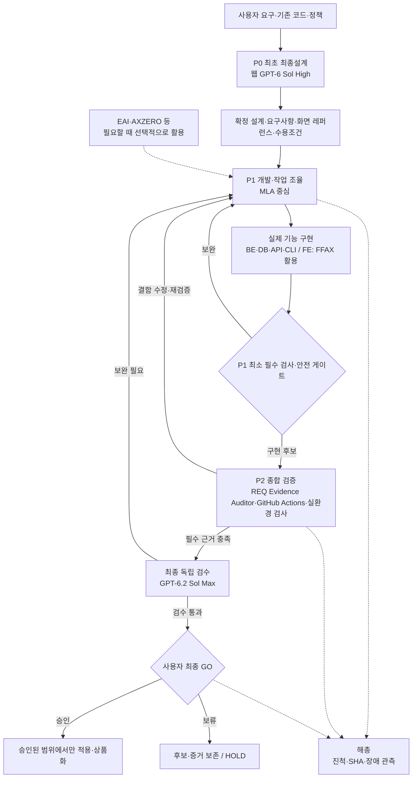

# AX 작업 생태계 — 향후 작업 로직도(목표)

**기준:** 2026-11-19 KST · **상태:** `TARGET_ONLY` (미구현 통합 목표, 현행 실행 정책 변경 아님)

**역할 원칙:** **웹 GPT-6 Sol High가 최초 최종설계**, **GPT-6.2 Sol Max가 최종 독립 검수**를 담당하는 것을 목표로 한다. Astra Max를 필수 설계·검수 단계로 두지 않는다. MLA·FFAX·EAI·AXZERO 등은 계속 변경·확장될 수 있으므로 이 문서에 내부 기능·API·작업 수량을 고정하지 않는다.

**운영 경계:** P1 실제 코드 구현과 P2 전체 검증은 분리한다. P1에서도 필수 국소 검사·보안·인증/권한·원본/DB 손실·F18 안전선과 기존 필수 CI를 유지한다. 스스로 수행한 검사는 독립 검수로 계산하지 않으며, 마지막 Sol Max 검수는 수행 전 `NOT_RUN`이다. 유료·고객/민감 원본 외부 전송·권한·main·Production·출시 등은 사용자 별도 승인 후 진행한다.

**현재와의 구분:** 미래 MLA 중심 구현과 GPT-6.2 Sol Max 단독 최종 검수는 목표 구조다. 전환을 실제 적용하려면 도구·모델 가용성과 제품별 안전/수용조건을 확인하고 사용자가 승인해야 한다. 전환 전 웹 Sol High의 현행 P1 구현 책임, 제품별 최종설계 및 중앙 `AGENTS.md`/정본 정책은 유지한다. 모델 호출·속도·품질 개선 효과는 실측 전 `UNMEASURED`.

**변경 범위:** 중앙 미래 로직도만 수정. MLA/FFAX 등 제품 소스·세부 설계·기존 운영 정책·main/Production 변경 없음. 이전 상세 조사 및 Astra 참고자료는 이 파일의 Git 커밋 이력에서 보존된다.
