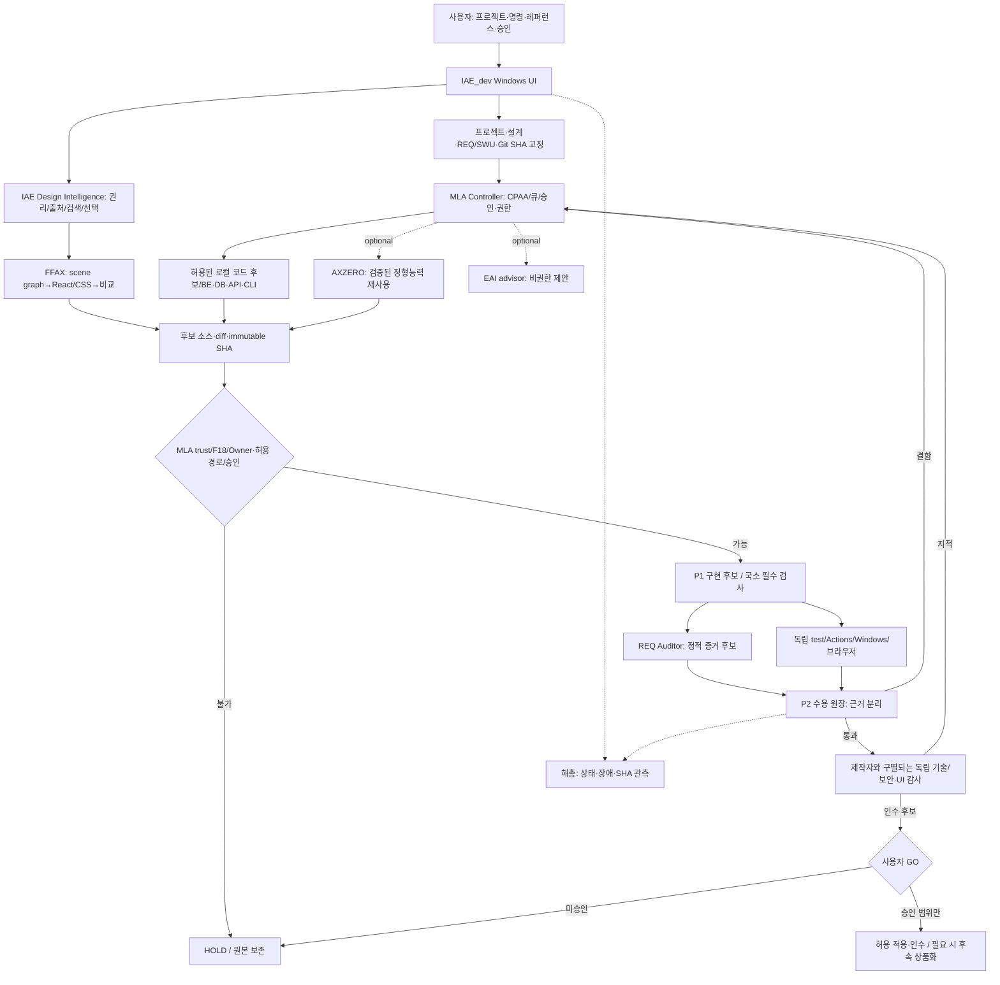

# IAE_dev — 제1 작업 생태계 통합 최종설계 v1.1

> **기준:** 2026-11-19 KST / 사용자 지시로 확정된 IAE_dev P0 **통합 목표·기술 설계**.  
> **현재 증거:** `DESIGN_LOCKED_NOT_IMPLEMENTED`; IAE_dev 앱·EXE·어댑터 E2E `NOT_RUN`; 공식 구현/검증률 `UNASSESSED`; 상용·Production `RELEASE_HOLD`.  
> **원본 역사 보존:** [기존 목표 로직도](IAE_DEV_FIRST_WORK_ECOSYSTEM_TARGET_20261119.md), [공통 미래 개발 흐름](FUTURE_DEVELOPMENT_WORKFLOW_TARGET_20261118.md).  
> **실행 단위/수용:** [IAE_dev REQ·SWU·P2 실행계획](IAE_DEV_IMPLEMENTATION_AND_ACCEPTANCE_V1_20261119.md).  
> **권한 우선:** 사용자 현재 지시/승인 → 각 제품의 최종설계·안전규칙 → 해총 최신 `AGENTS.md` 및 `OWNER_DEV_EXECUTION_CANONICAL_20261116.md` `0J / `GPT6_HIGH_STANDARD_WORK_UNIT_20261117.md` `0E → 실제 원격 HEAD/코드/증거. 이 문서는 다른 제품 정본을 덮어쓰지 않는다.

## 0. 제품 정체성과 절대 범위

- **IAE**는 사용자 장기 AI 생태계의 상위 비전. **IAE_dev**는 그 첫 번째이자 지금 개발할 **소프트웨어 개발 작업 생태계**다. 후속 생태계는 미정이며 이번 개발 범위 밖.
- **한 개의 Windows 진입점 + 한 개의 개발 대시보드 + 독립 전문 엔진의 버전 고정 어댑터**. 모든 엔진을 한 저장소/프로세스에 합치지 않는다.
- 대상: 사용자가 프로젝트를 선택하고 최종설계·REQ/SWU·Git SHA를 확인한 뒤 명령을 입력하여, **P1 구현 후보 → P2 실제 검증·수정 → 별도의 독립 감사 → 사용자 GO**까지 증거를 확인하는 개발 워크스테이션.
- 초기 환경: Windows 11 Pro, GTX 1050 Ti, RAM 16GB, Python 3.11, 현재 로컬 Ollama/Qwen3 4B. **무료·로컬·CPU-first**, 외부 모델 기본 OFF. 클라우드/네트워크/유료 호출/원본 업로드/원격 운영은 필수 요건이 아니다.
- 사용자 **`ㄱ`/`ㄱㄱ`은 IAE_dev에서 명시적으로 선택·고정한 하나의 프로젝트**에만 적용; 무작정 여러 repo에 브로드캐스트 금지. **해총 채팅 단독 `ㄱ`의 기존 GitHub App 임무는 그대로**다.
- 초기 목표는 로컬 본인용 개발 도구. 크몽 게시/고객 인도/실서비스 배포는 별도 사업 범위와 GO.

## 1. 확정 아키텍처 선택과 후보의 구분

| 결정 | 상태 | 설명 |
|---|---|---|
| Windows 단일 작업대 UI + 독립 엔진 | **구조 확정** | 외관은 한 앱, 실행/검증/권한은 제품별 독립 |
| Python BE + React/TypeScript 통합 UI | **P0 우선 구현 경로** | 기존 제품 기술 활용, 계약/보안 우선 |
| 로컬 앱 패키징 | **Windows 설치형 목표 확정** | 초기 loopback 대시보드 → 실환경 패키징 |
| Tauri 2 + WebView2 + Python sidecar | **우선 비교 후보** | 필수 확정 아님; Electron / 기존 네이티브 GUI와 자원·보안·복구·배포 실측 비교 후 결정 |
| 로컬 데이터 | **SQLite/WAL + 파일 아티팩트 인덱스** | IAE_dev는 요약/참조만 보관; 각 엔진의 원본 DB를 소유·이동하지 않음 |
| MLA | **핵심 제어 엔진** | 작업 큐·SWU/CPAA·모델·Git·실행 경계 |
| FFAX / REQ Auditor / Actions | **기본 개발 경로의 핵심** | FE 구현·증거 분석·실제 CI 검증은 책임 분리 |
| IAE Design Intelligence | **IAE_dev 고유 필수 모듈** | 레퍼런스·권리·선택·취향 관리; 생성/복원 엔진은 FFAX |
| AXZERO / EAI / AXNODE | **선택형 확장** | OFF/미구현이어도 기본 경로가 작동. AXZERO 완성 이후 재사용의 핵심적 가속 기능 |
| 해총 | **관측 연결** | 중앙 SHA·상태·장애/원장 읽기; IAE_dev의 실행·고객 승인권 없음 |
| 모델별 담당 | **현행 정책 우선** | 12월 실제 정책·가용성·사용자 전환 전 웹 GPT-6 High가 P0·P1 직접 책임. 미래 별도 독립 리뷰어는 가용성과 독립성 검증 후 |

## 2. 제품별 역할, 원본 보존과 실제 연결

| 구성 | 원본/정본 위치 | 역할 | 통합 경계 |
|---|---|---|---|
| IAE_dev 앱 | **미생성 전용 소스 repo**; 이 파일은 해총 중앙 **설계 정본** | UI, 프로젝트 선택, adapter registry, evidence index, 조작·로그 | **신규 앱 코드**; 원본 제품 코드 복제 최소화 |
| **MLA** | `hibi89/my_local_ai@dev/instant-implementation-v1` | Controller, Qwen/OpenCode 후보, 승인, 안전한 실행/원장/다음 READY | 실제 F18·Owner 경계 최종 권위 유지 |
| **FFAX V3** | `hibi89/frontend-foundry-ax@feature/ffax-reference-fidelity-20261118` | 참조 디자인의 scene graph → React/CSS → 실제 화면 비교/보정 | 목표 F95 95점은 **실측 미확인**, 소유자 시각 승인·자산 권리 분리 |
| **REQ Evidence Auditor A** | `hibi89/REQ-Evidence-Auditor-A-@integration/reqea-p1-20261118` | REQ↔소스·호출 그래프·근거 후보, JSON/HTML 보고 | 정적 후보≠기능/보안 실제 PASS; B/C는 A로 통합된 원본 |
| **IAE Design Intelligence** | IAE_dev 신규 로컬 모듈 | 이미지/URL/영상 입력·출처/권리/태그·프로젝트별 취향·썸네일/선택 | 자동 크롤링/메일/권리 없는 외부 수집 기본 OFF |
| **AXZERO** | `hibi89/Freelancer@product/ax-zero-local` | 성공 trace→반복 규칙·계약→제한 IR/프로그램 후보→독립 검증→무AI 재사용·drift/rollback | **아직 설계 전용**; MLA Controller 승인과 F18 불가침. MLA가 AXZERO 결과를 직접 VERIFIED로 격상 금지 |
| **EAI V3.2** | `hibi89/EAI@feature/eai-v32-owner-rebuild-20261119` | 추가 진단·CPU 기반 전략 제안 | 비권한 advisor; EAI 제품 고유 모델·안전 규칙 보존 |
| **AXNODE** | `hibi89/Freelancer@product/axnode-sector-runtime` | 선택적 능력/증거 export·장기 호환 | 필수 의존 아님; 실제 실행/신뢰/호환 보증 아님 |
| **GitHub Actions + 로컬 검증기** | 제품별 repo/branch workflow | 실제 test/CI/build/security·UI E2E 및 환경증거 | workflow 'Ready'/정적 pass≠Windows 소유자·고객 수용 |
| **해총** | `hibi89/hackathon-command-center-2026@kmong-productization` | SHA, CI 결과, 장애, 진행률·인계 관측 | GitHub App→HMAC→Vercel→Actions 운영의 고유 임무 불변 |

**동일한 소프트웨어 컴포넌트를 서로 중복 구현하지 않는다:** MLA는 Controller/권한, AXZERO는 경험을 재사용 가능한 모듈로 컴파일, REQ Auditor는 정적 근거 분석, FFAX는 FE 생성·충실도, IAE_dev는 통합 UI/인덱스/어댑터다. AXZERO를 MLA에 **사용자 경험상 내부화**하되 원본 AXZERO 브랜치와 검증기 책임은 유지한다. AXZERO는 REQ Auditor의 정적 결과만으로 자신을 검증했다고 선언할 수 없다.

## 3. 실제 종단 간 아키텍처

**중요:** P1 안전 검사 전 P2 전체를 반복하지 않지만, 인증/권한·원본/DB 손실·비밀·F18·고위험 실행 경계는 P1에서도 즉시 검증한다. 작업별 실제 Windows Owner 승인 불충족 시 정상적인 실패는 `HOLD`다. P2 검증기가 같은 생성 모델에 종속되면 독립 PASS 불가.

## 4. 사용자 UX·화면 계약

IAE_dev 실행→프로젝트 한 개 선택→원본 repo/branch/HEAD·확정설계·REQ/SWU·현재 담당/승인 범위 확인→명령 입력(`ㄱ`/`ㄱㄱ`/자연어)→READY 계획·허용경로·위험 미리보기→실제 실행 또는 HOLD→결과 diff/FE 미리보기/증거·승인→다음 SWU.

- **Home/Projects:** 프로젝트 카드, HEAD/소스 SHA, 정책 SHA, 작업중/차단, owner intervention, 출시 HOLD.
- **Command/Work Queue:** 선호 모델, CPAA 의존 DAG, SWU(S/C/I/D/U), 진행·재시도·2+2, 경로 충돌·대기열, 시작/중지/재개.
- **Blueprint/Requirements:** P0 확정본, REQ/SWU 수용조건, 정책 변경과 설계 수정안의 명시 구분.
- **Design Intelligence:** 파일/URL/영상/스냅샷 보관, 권리·태그, 프로젝트별 선호; 기본 **16개 경량 썸네일**에서 선택, 정밀 후보 1개 또는 변형 3~4개에 계산 집중.
- **FFAX Workspace:** 선정 레퍼런스→자산/scene graph/React CSS→동일 viewport/DPR 실제 Chromium 캡처 비교→부분 수정/사용자 확정. 캡처 배경 삽입만으로 FE 구현 PASS 금지.
- **Evidence/P2:** REQ 정적 후보, 실행 test, 보안, Windows/브라우저, 독립 리뷰, GO를 다른 컬럼으로 표시. P1 소스 구현후보≠P2 VERIFIED.
- **AXZERO Library:** 선택형. 성공 trace/능력 계약/지원 입력범위/검증기 SHA/변경·롤백/실제 AI 무호출 수와 한계 보여줌. 기능 미구현은 `OFF/NOT_AVAILABLE`로 표시.
- **Operations:** 로컬 GPU/CPU/RAM/디스크·비용·시간, Git/Actions/해총, 중단/체크포인트·복구/오류 로그.
- **설정·승인:** 기본 OFF인 네트워크·외부모델·파일 쓰기·원격 Git 동작, 정책별 별도 세부 GO와 철회.

앱은 접근성/키보드·한국어 IME/125~200% DPI/저사양 반응형을 P2에서 실제 확인한다. 초기 웹 대시보드에 **허위 실행 버튼·가짜 퍼센트·위조 성공 배지**를 만들지 않는다.

## 5. 기술 스택·프로세스 책임

| 계층 | 우선 기술 | 보류/검증 항목 |
|---|---|---|
| FE | React + TypeScript + CSS, 기존 FFAX 산출물 재사용 | 실제 FE 경량 번들·a11y·UI 스냅샷 검증 |
| Windows 셸 | Tauri 2/WebView2 **후보** | Rust 빌드·WebView2 설치 상태·sidecar 생명주기·공급망·서명·자원 실측; Electron/기존 Tk 대안 비교 |
| Host adapter | Python 3.11 stdlib·제한된 loopback API/IPC | 127.0.0.1 바인딩·origin/host/CSRF·토큰·프로세스권한/종료·named-pipe 혼동 금지 |
| MLA/REQ/AXZERO/EAI | 각 제품 Python CLI/API/버전 pin 호출 | Python 신뢰 경계 보존, import side effect·무권한 자동 설치 방지 |
| FFAX | Node.js/React/CSS/Chromium | 포트·실행자원·입력 이미지 라이선스·패키징 |
| 모델 | Ollama + 로컬 Qwen3 4B | 동시 모델 1개·자원 상한. 외부 모델 유료/전송 OFF, 가용성 확인 전 모델명 고정 계약 금지 |
| 저장 | IAE 자체 SQLite WAL 메타데이터 + 파일 digest, 각 엔진 DB는 별개 | one-writer/backup/restore, 임의 원본 복사 금지 |
| SCM/CI | Git/gh, GitHub API/Actions, SHA-pinned refs | 오프라인 시 읽기 전용 캐시, remote write·main merge·workflow_dispatch 별도 승인 |
| 검사 | Python AST·REQ Auditor, pytest 등 각 엔진 검사, Playwright/Chromium, 보안 스캔 | 작성자 self-pass를 외부 독립감사로 혼동 금지 |
| 이미지 | FFAX 기존 분석기 우선; OpenCV/Tesseract.js/pixelmatch는 **선택 후보** | OCR/시각 유사도·권리·라이선스·RAM 실제 검증 |
| 배포 | 앱 설치형 목표; 필요 시 Python sidecar PyInstaller 후보 | EXE 빌드≠실기기 PASS, 서명·백신·복구·업데이트·권한 최소화 검증 |

**비용/의존성 원칙:** 새 상용 도구 구독, 원격 서버, VM/Hyper-V/WSL2/Docker, 유료 API, GPU 대형 비전 모델을 필수로 만들지 않는다. MLA의 **Zero-VM / Typed Operator / CodeShield / Owner·F18** 정책을 우회하지 않는다. Worktree는 OS 샌드박스가 아니다. 비신뢰 임의 코드 실행은 안전한 격리·별도 승인·독립 수용 이전 `HOLD`.

## 6. 안정적인 어댑터 계약과 실패 원칙

**공통 입력 (`IntegrationRequestV1`, 데이터 계약 목표):** `request_id,project_id,repo,branch,expected_head_sha,design_sha,policy_sha,swu_ids,req_ids,allowed_paths,owner_scope,read_or_write_scope,risk_tier,timeout_ms,resource_budget,reference_asset_digests`.

**공통 출력 (`IntegrationResultV1`):** `request_id,engine,engine_version,source_sha,artifact_sha,result_kind,status,observed_outputs,evidence_uris,evidence_sha,attempt_id,elapsed_ms,actual_model_calls,blockers,requires_owner_approval`. `status`는 `CANDIDATE/PARTIAL_PASS/SCOPED_PASS/HOLD/NOT_RUN` 등 출처와 조건을 포함. **검증·독립감사·사용자 GO를 하나의 boolean으로 합치지 않는다.**

- 모든 엔진은 **명시적 실행 요청·bounded timeout·취소·멱등 request_id·소스 SHA 재조회·capability handshake** 후에만 호출한다. 버전 불일치, 미설치, 권한 없음, stale SHA, 잘못된 응답은 **typed fail-closed HOLD**.
- **읽기 전용 모드가 기본**. 외부 소스 URL/고객 원본/토큰·.env·프롬프트는 GitHub 공개 repo나 불필요한 provider에 송신하지 않는다.
- MLA는 실행·Owner·F18의 **유일한 authoritative boundary**. AXZERO `EXECUTE_NO_AI`는 AXZERO 정책상 후보일 뿐, MLA 승인·F18 없이 최종 실행 허가가 아니다.
- REQ Auditor는 정적 code-evidence 후보만 생성; P2 실행 결과 및 독립 기술감사는 별도 origin+SHA+실행 증거로 판정한다.
- IAE_dev는 제품별 DB/파일을 직접 수정하지 않고 어댑터의 최소명령/읽기 전용 조회를 통해 접근한다. 분산 트랜잭션을 가정하지 않고 idempotent receipt+reconcile로 장애 복구한다.
- **Adapter OFF / not found**: FFAX 부재 시 FE 경로만 HOLD·독립 BE READY는 계속. REQ 도구 부재 시 증거를 추측하지 않고 P2 관련 게이트 HOLD. AXZERO/EAI/AXNODE 부재 시 기본 MLA→소스→REQ/CI 흐름은 계속.

## 7. Design Intelligence–FFAX 계약

- `ReferenceRecordV1`: `asset_id,project_id,content_sha,source_uri_or_local,rights_status,license_note,owner_consent,viewport,dpr,motion_reference,style_tags,created_at`. 이미지 자체와 민감 출처는 로컬 전용; 원격 전송은 별도 opt-in/권리 확인.
- 일반 취향과 프로젝트별 취향/선택·수정 이력을 분리한다. 가중치(프로젝트 적합성 45%/다양성 35%/개인 취향 20%)는 **실증 전 휴리스틱**; 16개 미리보기는 **경량 기존 자료**, 고비용 16개 신규 렌더가 아니다.
- `SelectedReferencePackageV1` = 선택한 이미지/정당한 자산/고정·변경 요소/권리/뷰포트/DPR/기준 SHA. 이 객체를 FFAX에 전달하고 FFAX 원본의 구현/수용 계약을 따른다.
- F95 ≥95/100은 **성능 목표이지 현재 검증값 아님**. 폰트·숨겨진 상태·모션·버튼/라우팅·API·모바일은 원본 스크린샷 한 장만으로 보장할 수 없고 **별도 수용**한다.
- 자동 외부 트렌드 크롤링/주간 Gmail 발송은 향후 사용자 opt-in 및 원본 출처·권리 검토 이후, 초기 필수 경로 제외.

## 8. AXZERO–MLA–REQ Auditor 결합 (중요)

1. MLA가 실제 수행한 허가된 작업의 최소화·비밀 제거된 trace만 AXZERO에 전달한다.
2. AXZERO가 반복성·계약·반례를 검토해 제한된 typed IR/작은 프로그램 후보 및 독립 검증 증거를 생성한다. **과거 일회 성공은 자동 승격 근거가 아니다**.
3. 입력/환경 digest·정책·효과 계약·지원 범위가 동일할 때만 `NO_AI` 재사용을 제안한다.
4. MLA의 별도 정책·F18·Owner 승인이 이를 심사한다. **REQ Auditor 정적 PASS만으로 실행 승인 불가**; 실제 동작 oracle/보안/복구·독립 테스트 필요.
5. 범위 밖·drift·verifier 불일치·부작용·외부쓰기·계정 미승인 → 기존 verified artifact를 보존하고 해당 작업만 HOLD/필요 시 AI·인간 재검토. 무조건 안전하지 않은 구버전 실행 금지.
6. 성공 기록은 `actual_model_calls,baseline_sha,artifact_sha,latency,resource_use,correctness,declined_tasks,maintenance_overhead`로 계측한다. AXZERO 최초 미구현 상태에서도 정상 개발 흐름을 유지한다.

**성공 기준:** 기존 로컬 Qwen 경로 및 사전 작성 스크립트와 같은 입력·검증 기준으로 비교해 **정확성과 보안을 희생하지 않고** 총경과시간/호출량/유지보수 비용이 개선될 것. 무AI 호출률의 분모는 시행 전 확정된 eligible 실제 작업이며, 가상 절감률/임의 마케팅 수치 금지.

## 9. 상태·권한·데이터 안전

- **상태:** `NOT_RUN, READY, RUNNING, IMPLEMENTED_UNVERIFIED, PARTIAL_PASS, SCOPED_PASS, VERIFIED, BLOCKED_TRUST, ISOLATED_REDESIGN_PENDING, SOLMAX_BATCH_PENDING, HOLD`를 단계와 출처별로 분리. 정적 후보 PASS·CI PASS·실 Windows owner PASS·독립 검수 PASS·GO·실 게시 증거는 **별개**.
- **구현률:** P1 실제 완료 SWU/승인된 고정 SWU 분모. **검증률:** P2 승인된 수용조건 실제 PASS/분모. 가중치/분모 미확정은 `UNASSESSED`, 임의 %/100% 금지.
- **개발 2+2:** SWU별 실제 무진전 2회 시 격리→다른 방법 2회→4회 전문 일괄 의뢰. 고위험 임계경로는 근거 확인 후 0회부터 전문 지원 가능. 준비/문서/폴링은 실패회수 미산입.
- **승인 필요:** 유료 결제, 민감 고객 원본 송신·변조, 인증/권한/OS/보호서비스 변경, 위험 DB 수정, 제품 기능 축소, 외부 API 활성화, Git remote 자동 쓰기/브랜치 통합, main·Production·도메인·환경변수, 상용 출시. 원본/백업/커밋 보존, force push 금지.
- **보안:** localhost/Origin/Host/CSRF, 경로 이탈·symlink/reparse·TOCTOU, 확장자·콘텐츠 digest, prompt injection, git lease/epoch, 서명 영수증 위조, 임의 shell/`exec`, 비밀노출, 악성 수집 URL/SSRF, DoS, 파일권한, 업데이트 공급망, 설치·삭제 백업을 실제 검사한다.
- **복구:** 한 프로젝트의 장애가 다른 READY를 막지 않음; one-writer SQLite, idempotency, WAL/checkpoint, 모듈 별 OFF/safe-mode, 손상 증거·백업 복원, 충돌 시 HOLD. 오프라인이면 읽기전용 캐시 및 로컬 허용 작업만.
- **성능:** 동일 PC에서 CPU/RAM/VRAM/디스크·1모델 상주, UI와 Chromium/MLA/FFAX 동시 peak, 모델 cold/warm, 1일~장시간 resume, 패키징 크기/시작/종료 시간을 **실측 전 보장하지 않는다**.

## 10. 실행 우선순위·불필요한 선행 대기 제거

**세 가지 작업 트랙으로 나눠 의존성을 최소화한다.**

- **A. 기존 제품 안정화(제품별 원본):** MLA의 F18/Owner·보호 환경 신뢰 차단, FFAX 실제 레퍼런스 충실도·실 사용자 AC, REQ Auditor 실제 Windows·장시간·독립감사, EAI 필요한 선택 연동 범위를 각각 P1/P2 원장대로 마무리. 어떤 제품의 미수용을 다른 문서로 PASS 처리하지 않는다.
- **B. IAE_dev 최소 구현(신규 소스, A 일부와 병행 가능):** 새 앱 REQ/SWU 확정→프로젝트/HEAD 읽기전용 → REQ/SWU 및 증거 대시보드 → 명령 intake/허용 계획 미리보기 → 한 프로젝트에서 MLA/FFAX/REQ/Actions **실제 caller→callee** 연결. 안전한 읽기/합성 코드만 사용하며 아직 막힌 Owner 실권한을 우회하지 않는다.
- **C. 독립 확장(A·B와 병행 가능):** AXZERO 실제 18 P1 태스크/36 REQ부터 개발, Design Intelligence 로컬 레퍼런스 라이브러리, EAI 선택 advisor, AXNODE 선택 export. AXZERO 완성 전 B의 기본 통합을 **대기시키지 않는다**.

**실제 구현 우선:** 사용자가 조작할 수 있는 **프로젝트 선택→현재 설계·HEAD→SWU·증거 읽기→명령→실제 안전한 후보 결과** 1개 수직 경로가 첫 제품 합격점이다. 단순 화면 목업/임시 가짜 성공 상태는 P1 완료 인정 불가.

**패키징 게이트:** 로컬 UI와 BE/FE/REQ 최소 경로 정상 작동 뒤에 Tauri/Electron/Tk 비교·선택 → Windows 설치형 EXE/sidecar → 실기기 네트워크 차단·복구·계정권한·Korean UX 검증. 보기 좋은 EXE만으로 자동개발 완성 주장 금지.

## 11. P0~P5와 독립 검수

- **P0 본 설계:** IAE_dev 소유자 목표·시스템 경계·최초 REQ/SWU/P2 계획을 고정. **GitHub 문서화만으로 제품 구현률 증가 없음**.
- **P1:** 웹 High가 현행 CPAA→WE(`ㄱ`당 1~6 READY)로 BE/FE/DB/API/CLI 실제 구현·국소 syntax/type/smoke·핵심 안전 검사와 SHA 반영. 현행 CI/branch protection 유지. 12월 모델 전환은 적용 확인 및 사용자 결정 이후만.
- **P2:** 정확 SHA 위에서 CI/보안/통합/회귀/실 브라우저/Win11/UX/DR/오프라인/리소스 및 결함 재검증. 일부 생략은 ``NOT_RUN` 명시; 공식률은 승인 수용 기준.
- **P3:** 제작자와 **독립된** Codex 기술·보안 감사와 별도 UI/UX 감사(실제 가용·담당 검증), 또는 사용자 승인된 동등 독립 검수. 본인 검사=독립 감사 아님.
- **P4:** High 전수 인수, 차단·수정·원본·권리·증거 재확인.
- **P5:** 사용자 별도 GO 이후 승인 범위 로컬 실사용/원격·상품화·배포, 판매 등록은 실제 URL/게시일 있어야 완료.

## 12. 측정할 사업·기술 성과 (모두 실측 전 UNMEASURED)

- 같은 작업/동일 기준 SHA에서 **High/Max 호출 횟수, 로컬 모델 호출·토큰, P1 100% 후보까지 전체 경과시간, P2 통과까지 시간, 재작업율, 위험 보류율, 모델별 실패**를 비교.
- AXZERO는 정확도·권한·독립 검증이 유지되는 eligible 집합의 **무AI 성공률, 절감 토큰/시간/비용, drift 거부율, 재검증 유지비**를 분리.
- FFAX는 F95의 실제 참고 이미지 집합, 뷰포트/DPR, 화면·기능·모션 수용을 따로 제시; 사람이 승인한 실제 원본 수와 합성 fixture 수 분리.
- UX는 프로젝트 선택부터 첫 실제 변경 근거 확인까지 조작횟수, 차단 사유 식별, 한국어 IME, Windows 시작/복구, CPU/RAM 상한 준수로 평가.
- **중단/재설계 기준:** 기존 단순 스크립트보다 AXZERO 관리비가 크거나, 검증 독립성을 보장할 수 없거나, 통합 앱이 원본 제품을 불안정하게 만들면 해당 선택 확장만 HOLD하고 IAE_dev 본경로는 계속.

## 13. 정확한 현재 상태와 다음 작업

- **원격 해총:** `hibi89/hackathon-command-center-2026@kmong-productization`. 기존 목표 문서는 2026-11-19 `TARGET_ONLY`로 남겨 역사 보존; 본 문서는 사용자가 확정 요청한 **IAE_dev 통합 P0 설계 정본**이다.
- **IAE_dev 공개 저장소 `hibi89/IAE_dev`와 P0·개발·통합·검증·기능별 브랜치는 생성 완료, 실제 앱 소스 코드/EXE는 미구현**; 등록/배포/실기기/성능 검증은 `NOT_RUN`. 공식 IAE_dev P1/P2 진척 **UNASSESSED**. 신규 SWU/REQ는 [실행계획](IAE_DEV_IMPLEMENTATION_AND_ACCEPTANCE_V1_20261119.md)에만 명시; 원본 MLA/FFAX/AXZERO/REQ 분모와 합치지 않는다.
- **최초 실제 개발 준비:** 사용자 지시에 따라 `hibi89/IAE_dev` 공개 repo 및 `design/iae-dev-final-v1`, `dev/iae-dev-p1-20261119`, 통합/검증/기능 브랜치를 생성하고 `AGENTS.md`·`HANDOFF.md`·`STATUS.md`·REQ·P1/P2 JSON 큐를 기준선화했다. 다음 단계는 최신 `dev` HEAD·안전·의존성을 다시 확인한 뒤 첫 READY 수직 코드 구현이다.
- **현행 임무 보존:** 해총 단독 `ㄱ`은 기존 GitHub App 모니터링·자동화 작업이다. 이 문서 등록만으로 그 임무, 다른 제품의 코딩·안전·P2 상태, main/Production·외부 통신·유료/고객 원본 승인 범위를 바꾸지 않는다.

## 14. 2026-11-20 사용자 승인 외부 AI 설계 v1.1 — 정책 우선

**현행 추가 정본:** [외부 AI 최적 라우팅·Hydrogen 20회 정책](../EXTERNAL_AI_ROUTING_V1_20261120.md) / [기계 판독 정책](../../data/EXTERNAL_AI_ROUTING_POLICY_V1.json). 이전 0~13절의 외부모델 "기본 OFF" 및 사용자 GO 경계 유지. 기존 IAE_dev 28 REQ/22 P1 SWU/9 P2 게이트 분모 불변.

1. 검증된 AXZERO 정형 능력(실제로 존재하고 MLA/F18 허용할 때)·MLA 로컬 Qwen → 공개/합성 비민감 데이터의 **일반 외부 Gemini Flash** → 정말 필요한 특별 난제만 **Gemini 4 Hydrogen** → 사용자/독립 검수. 모델은 조언자일 뿐 실행 권한은 MLA만.
2. 사용자가 말한 3.5 Flash 역할을 보존하되 Google 공식 2026-10-08 deprecated 공지에 따라 실제 API 후보는 `gemini-3.6-flash`로 **계정 모델·무료 tier·한도 재확인 후 선택**한다. 실제 모델 API와 다른 앱·계정 사용량을 추측하지 않는다.
3. Hydrogen `gemini-4-hydrogen` **내부 rolling24h 최대 20건**, 고위험 긴급 4건 예약, 작업당 1회, 동시 1, 자동 재시도 0. 20은 사용자가 설정한 보수적 IAE_dev 예산이며 Google 공식 계정 한도 단정이 아니다. 실제 provider 제한이 더 낮으면 그 제한 적용.
4. **외부 AI는 기본 OFF/무료 확인 미완/비용 0원 설정**. 자격·실 사용한도·공개/합성 데이터 분류·요청별 Owner 승인 이전에는 API 호출·데이터 송신 금지. Flash 429를 Hydrogen 자동 소모의 이유로 사용하지 않는다.
5. IAE_dev provider router는 무료 여부/요청 할당량/원자적 SQLite WAL 예약·예외·모델 ID/응답/토큰·비용·차단 사유를 관리하고, MLA Zero-VM/CodeShield/F18/Owner, REQ와 실제 테스트, 독립 감사, 사용자 GO를 절대 우회하지 않는다.
6. 실기능 코드 범위는 기존 **IAE-SWU-006/007/018/019/020**, P2-05/06/09를 보강한다. 외부 모델·CI·Windows 검증은 별도 수용 전 `NOT_RUN`, 본 변경 자체는 **docs-only P0**.

> **IAE_dev 원본 P0 기준:** https://github.com/hibi89/IAE_dev/blob/design/iae-dev-final-v1/docs/strategy/IAE_DEV_FINAL_BLUEPRINT_V1_20261119.md (2026-11-20 동기화; 제품 자체 정본이 우선이며 해총 GitHub App 고유 임무 불변).
