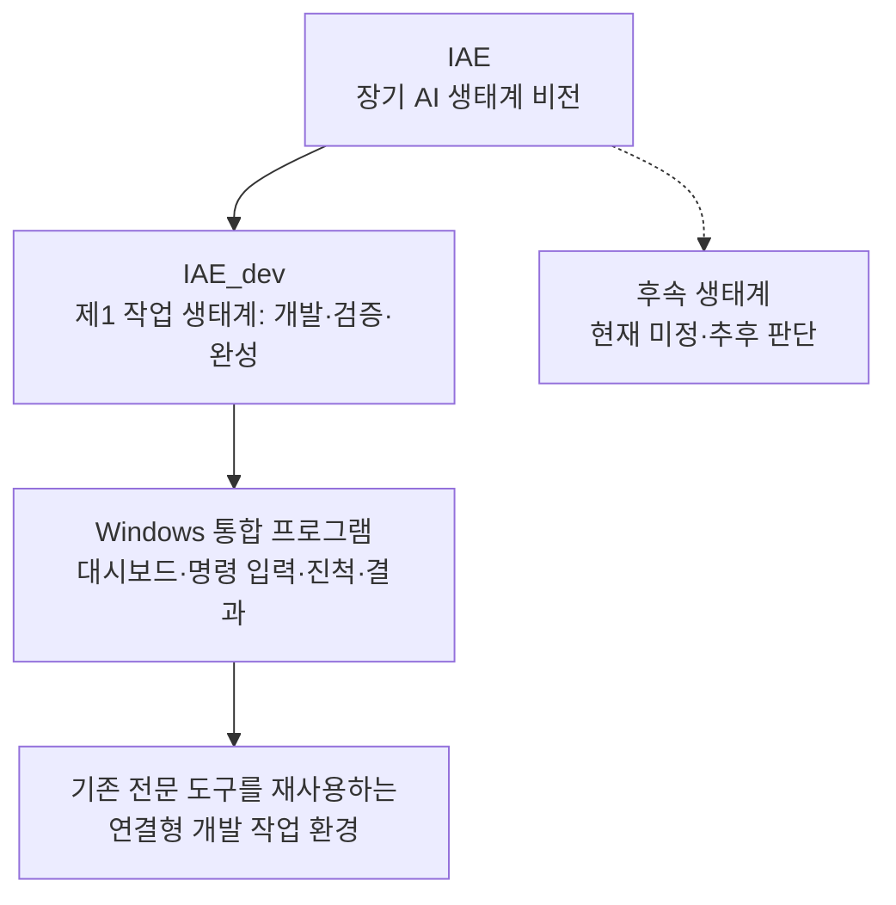
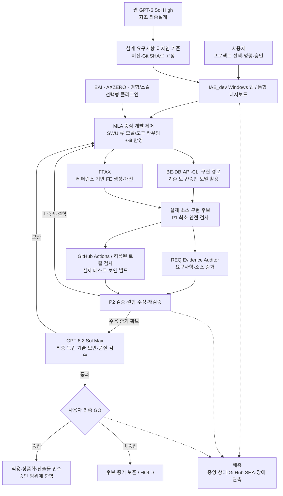
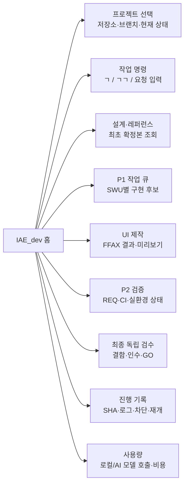
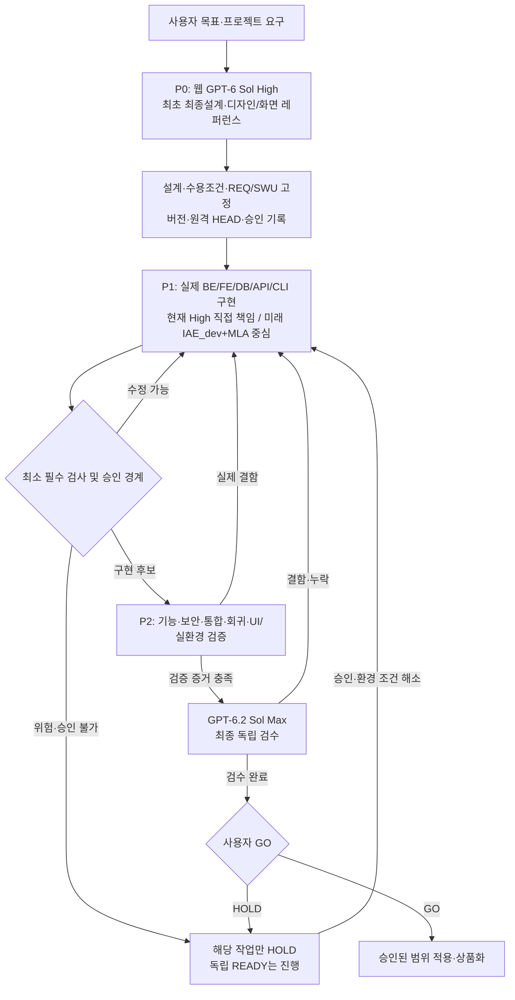
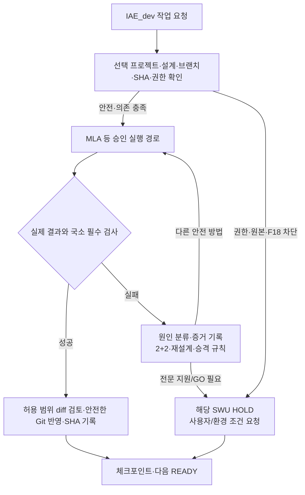

# IAE_dev — IAE 비전의 첫 번째 작업 생태계 (목표 설계)

> **명칭:** IAE_dev  
> **상위 비전:** IAE — 사용자가 AI를 활용해 장기적으로 구축하려는 전체 생태계  
> **첫 번째 실행 영역:** IAE_dev — 실제 소프트웨어 개발 작업 생태계  
> **상태:** TARGET_ONLY / 통합 프로그램 미구현 / 모델·통합 효과 UNMEASURED  
> **기준:** 2026-11-19 KST · 소유자 지시를 정리한 미래 방향 문서. 현재 제품별 정본 및 중앙 실행 정책을 덮어쓰지 않음.

## 0. 목적: 왜 IAE_dev를 만드는가

**IAE가 사용자가 AI 개발을 진행하는 근본 목적이며, IAE_dev는 그 비전을 현실화하는 첫 번째 작업 생태계다.** 단일 프로그램을 하나 더 판매하려는 목적보다, 앞으로 이어질 다양한 프로젝트를 더 적은 반복 지시와 모델 호출로 설계·구현·검증·완성하는 **사용자 자신의 개발 작업 기반**을 먼저 구축하는 것이 목표다.

- **하나의 진입점:** 여러 전문 도구가 있어도 사용자는 Windows에서 IAE_dev 한 프로그램과 한 대시보드에서 다룬다.
- **재사용:** 이미 만들어 둔 코드·설계·컴포넌트·검증된 해결 방식·Git 이력을 우선 재사용한다.
- **품질:** 단순 AI 코드 생성이 아닌, 최초 설계부터 구현·검증·독립 감사·승인까지 증거에 연결한다.
- **무료/로컬 우선:** 현재 PC에서 가능한 범위를 먼저 활용하며 유료/외부 전송/권한 변경은 별도 승인받는다.
- **첫 번째 생태계 완성 우선:** IAE의 다른 생태계는 지금 상세 설계하거나 확장하지 않는다. 향후 실제 필요·성능·비용 증거를 확인한 뒤 결정한다.

**IAE_dev = 통합된 사용자 경험 + 변경 가능한 전문 엔진 + 공통 증거·안전 규칙.** 전문 프로그램을 하나의 거대한 코드베이스로 병합하는 방식이 아니라, 각 제품은 독립적으로 진화하고 IAE_dev에서 호출·관측·관리하는 구조다.

## 1. 상위 비전과 첫 번째 생태계

이 그림은 **IAE 전체를 IAE_dev와 동의어로 보지 않는다는 점**을 명확히 한다. 지금의 구현·검증·개발 자동화 목표는 첫 번째 생태계인 IAE_dev에 한정한다.

## 2. IAE_dev 전체 시스템 구조 (목표)

### 구성요소의 역할: 의도적으로 가볍게 유지

| 구성 | IAE_dev에서의 역할 | 설계 경계 |
|---|---|---|
| **IAE_dev 앱** | 사용자에게 제공되는 단일 진입점·작업 명령·시각화·진척/증거 조회 | 자체적으로 모든 엔진을 재구현하지 않음 |
| **MLA** | 작업 선택/실행·모델 및 도구 호출·Git 통합의 중심 | 실제 안전 게이트·허용 연산·제품 고유 정책 준수 |
| **FFAX** | 확정 레퍼런스를 활용한 프론트엔드 제작·개선 | 제품 자체 설계/프레임워크는 FFAX 저장소에 귀속 |
| **EAI·AXZERO 등** | 진단·반복 작업 재사용을 위한 선택형 지원 | OFF/미구현이어도 기본 경로가 유지되도록 |
| **REQ Auditor + Actions** | 정적 요구사항 증거와 실제 실행/CI 결과를 구분해 수집 | REQ 후보 ≠ 테스트 PASS ≠ 독립 감사 |
| **해총** | 프로젝트 상태·장애·원장 관측 | 개별 제품의 실행권이나 사용자 GO 대체 금지 |
| **웹 Sol High / GPT-6.2 Sol Max** | **최초 설계 / 최종 독립 검수**라는 사용자 확정 미래 목표 | 실제 모델 접근·독립성·전환 승인은 별도 확인 |

**MLA·FFAX·EAI·AXZERO의 구체 기능/API/내부 구조는 계속 변할 수 있으므로 이 문서에서 고정하지 않는다.** 각 도구의 현재 실제 계약은 해당 원본 GitHub repo/브랜치의 최신 정본을 읽고 적용한다.

## 3. 사용자가 보게 될 통합 대시보드

**대시보드의 최소 실제 사용자 흐름:** IAE_dev 실행 → 프로젝트 선택 → 해당 repo/branch/HEAD·승인 설계 확인 → 명령 또는 작업 시작 → 현재 가능한 안전 SWU 구현/검증 진행 → 진척 및 차단 사유 표시 → 실제 SHA·검사·검수 결과 확인 → 필요 시 사용자 승인.

- **명령 입력:** 선택한 프로젝트에만 `ㄱ`/`ㄱㄱ` 적용. 해총 채팅 자체의 단독 `ㄱ`은 기존 GitHub App 임무 그대로이며, IAE_dev에서 임의로 전체 제품에 브로드캐스트하지 않는다.
- **진척 표시:** P1 구현완료율은 실제 코드 SWU·승인 분모, P2 검증완료율은 실제 수용조건과 PASS 근거로 별도 표시. 분모/가중치 부재 시 `UNASSESSED`. 추정 막대·문서 건수로 완료 처리 금지.
- **모바일/외출:** 향후 읽기 및 안전한 실행 요청을 별도 검토할 수 있으나, 노트북이 꺼진 상태에서 로컬 앱이 자동 실행된다고 약속하지 않는다. 원격 요청·권한·작업 재개는 승인된 별도 경계가 필요하다.

## 4. 전체 개발 로직도 — 최초 설계부터 완성까지

- **현재 정책 vs 미래 목표:** 중앙 현행 실행 정본에 따라, 새 모델 정책/가용성 확인과 사용자 전환 결정 전까지 웹 Sol High가 P0와 P1 실제 구현을 직접 맡는다. 이후 MLA/FFAX 중심으로 P1 자동화를 확대하는 것은 목표다. GPT-6.2 Sol Max 최종 독립 검수도 가용성·역할 독립성을 확인한 뒤 적용한다. Astra Max는 IAE_dev의 **필수** 설계/검수 단계가 아니다.
- **검수 독립성:** GPT-6.2 Sol Max가 동일 후보의 제작/수정에 참여한 경우 그 동일 결과의 자기 검사를 독립 검수로 주장하지 않는다. 독립 리뷰어·검수 범위·최종 SHA를 별도 입증해야 한다.
- **증거 분리:** 소스 구현 후보(`IMPLEMENTED_UNVERIFIED`), P2 실제 PASS, 독립 감사, 사용자 운영 GO 및 실제 판매/출시는 각각 다르다.

## 5. 사용 형태 및 패키징 선택

**추천 형태: Windows 로컬 설치형 IAE_dev + 통합 대시보드 + 기존 제품을 호출하는 어댑터.**

| 방식 | 판단 |
|---|---|
| 제품 소스 전체를 한 저장소/프로세스에 물리적으로 병합 | **비추천:** 기존 코드·설계 소유권/독립 수정과 충돌 위험 증가 |
| 클라우드 서버만으로 전체 실행 | **기본안 아님:** 비용, 로그인/네트워크, 민감 원본 전송 및 로컬 실행 통제 문제 |
| **로컬 대시보드·제어 어댑터 + 독립 전문 엔진** | **우선 추천:** 사용자 경험을 하나로 만들되 제품별 독립성과 향후 확장을 보존 |

**기술 후보(확정 아님):** React UI로 통합 화면과 입력 흐름부터 검증하고, 필요 시 Tauri 2 등 Windows 셸로 패키징한다. 기존 Python/Node CLI 및 제한된 loopback API 연결은 실제 권한·자원·패키징 검증 결과로 결정한다. Tauri·Electron·기존 데스크톱 방식을 기능·실행 자원·복구·보안 기준으로 비교한 뒤 선택할 것. 특정 프레임워크·EXE·완전 자동 연결이 이미 구현된 것으로 간주하지 않는다.

**현재 환경:** Windows 11, GTX 1050 Ti, RAM 16GB 기준에서 CPU/메모리 및 모델 동시 실행을 제한하고, 무거운 엔진을 필요할 때만 켜는 방식 우선. 로컬 모델과 앱 셸의 자원 사용량은 실측 필요.

## 6. 오류 처리·재개·안전 원칙

- **실행 권한:** AI가 생성한 코드·스크립트·테스트는 미신뢰 입력이다. MLA의 현행 Zero-VM/F18·Owner 승인·보호 서비스·신뢰 경계가 해결되었다고 가정하지 않는다. 권한 없는 실행·임의 명령 수행·비밀/고객 데이터 전송 금지.
- **Git 안전:** 원본/백업/이력 보존, SHA 일치 확인, 허용 경로/브랜치 기준, 동시 쓰기 충돌 방지, 안전한 체크포인트·실패 복구. Force push 및 승인 없는 main/Production 변경 금지.
- **2+2 실패 처리:** SWU당 실제 무진전 초기 2회 → 격리/재설계 → 다른 방법 2회 → 누적 4회 전문 지원 요청, 필수 임계/고위험 사안은 즉시 요청 가능. 조회·문서·CI 폴링은 실패 시도로 계산하지 않는다. 독립 READY 계속.
- **비용/외부 자료:** 무료·로컬 우선, 유료 모델·외부 서비스·민감 원본 업로드·보안/권한/Production 변경은 사용자 별도 GO. 실제 비용·속도 향상과 Max 사용량 감소는 `UNMEASURED`.
- **검증:** REQ Auditor의 정적 후보, GitHub Actions의 실행 결과, 로컬/실기기 검증, GPT-6.2 Sol Max 독립 최종 검수, 사용자 GO를 각각 구분한다.

## 7. 단계별 구축 순서 (선행 관계만; 기간·성공률 추정 금지)

1. **기반 제품을 먼저 완성:** MLA·FFAX·REQ Auditor 및 필요한 EAI의 기존 P1/P2 미완료 항목·독립 감사·안전 게이트를 해당 제품 원본 저장소에서 마무리. 이를 문서 작성만으로 완료 처리하지 않는다.
2. **IAE_dev 최소 대시보드:** 프로젝트 선택·현재 HEAD/설계 조회·P1/P2 진척·검사/차단·명령 입력을 읽기 전용/합성 데이터로 확인. 새로운 실행 권한을 부여하지 않는다.
3. **실제 어댑터 수직 통합:** 선택 프로젝트 1개에서 설계→MLA SWU→실제 코드 후보/FFAX FE→REQ/Actions 증거→상태 표시까지 안전한 최소 범위를 검증. EAI/AXZERO OFF에서도 기본 경로 PASS 필요.
4. **로컬 Windows 앱 패키징:** 브라우저/대시보드 UI가 실제 작업에 적합한지 확인한 후 Windows 11 설치형 EXE와 자원·복구·보안·한글 UX를 검증한다.
5. **자동화 고도화:** F18·Owner 독립 실행 근거와 사용자 승인이 허용하는 범위에서만 자동 수정·재검증 확대. 스킬/경험 재사용은 재현된 이득과 안전 근거가 있을 때 활성화한다.
6. **모델 호출 최적화:** 같은 SWU·REQ/소스·기준 데이터에서 모델 호출·토큰·경과시간·오류·재작업을 비교해 High/Max 호출량 감소를 실측하고 운영 전환을 별도 승인받는다.
7. **후속 IAE 생태계:** IAE_dev의 실제 성과와 필요성이 확인된 뒤 새 영역을 논의. 현재 범위를 앞당겨 확장하지 않는다.

## 8. 문서·증거·변경 범위

- **IAE_dev의 상세 기능/REQ/SWU/선택 기술은 이후 별도 최초 최종설계에서 확정한다.** 이 문서는 사용자의 장기 목표·제품 관계·실행/안전 흐름을 잃지 않기 위한 **로직도 정본(목표)**이지 구현 확정 설계, 기술 검수 PASS, 출시 GO가 아니다.
- 중앙 미래 로직도: [FUTURE_DEVELOPMENT_WORKFLOW_TARGET_20261118.md](FUTURE_DEVELOPMENT_WORKFLOW_TARGET_20261118.md).
- 현재 개발 정본: [OWNER_DEV_EXECUTION_CANONICAL_20261116.md](OWNER_DEV_EXECUTION_CANONICAL_20261116.md) §0J 및 [GPT6_HIGH_STANDARD_WORK_UNIT_20261117.md](GPT6_HIGH_STANDARD_WORK_UNIT_20261117.md) §0E, 중앙 [AGENTS.md](../../AGENTS.md).
- 프로그램별 실제 구현/검증/원본 설계는 각 소스 repo의 현재 브랜치·정확 HEAD·최종설계·REQ/수용원장을 따른다. 추가 자료로 검토했던 Sol Max 설계 초안과 공개 레퍼런스는 참고 자료이며, 이 문서의 확정·도입 증거를 대신하지 않는다.
- **이번 저장 작업:** docs only. 제품 소스/AGENTS/현행 정책/CI·비밀·권한·main/Production 변경 없음. IAE_dev EXE·대시보드 구현 `NOT_RUN`. 구현률/검증률 추가 인정 0, 모델 독립 검수 `NOT_RUN`, 예상 속도·비용 효과 `UNMEASURED`.
