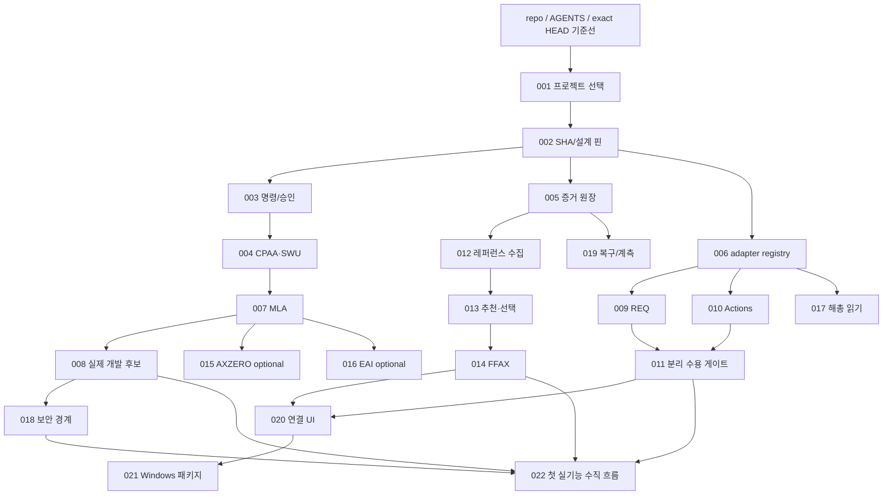

# IAE_dev — P1 REQ·SWU 구현·P2 수용 계획 v1.1

> 2026-11-19 KST · **IAE_dev 신규 프로그램 전용 계획/설계 기준선**. 상위: [IAE_dev 통합 최종설계](IAE_DEV_FINAL_BLUEPRINT_V1_20261119.md).  
> **현재:** 전용 공개 repo·P0 브랜치·초기 큐 생성 완료 / 실제 앱 소스 코드 미생성, 아래 모든 ID는 계획 수용조건. 구현·검증 **NOT_RUN**, 공식률 **UNASSESSED**, 출시 HOLD. 문서 28 REQ/22 SWU/9 P2 게이트는 **타 제품 분모에 합산하거나 완료로 인정하지 않음**. 개발 repo 출범 시 동일 ID·기능 범위·계약을 이식하고 SHA·실제 코드 증거로 상태 재산정.  
> **원칙:** 현행 중앙 `AGENTS.md`, `OWNER_DEV_EXECUTION_CANONICAL_20261116.md` `0J, `GPT6_HIGH_STANDARD_WORK_UNIT_20261117.md` `0E, 원본 제품별 AGENTS·최종설계가 우선. 신규 계획이 MLA/FFAX/REQ/AXZERO/EAI의 기존 SWU·안전·상품 범위를 변경하지 않는다.

## 0. 단계 잠금과 수치

- `P0_LOCKED_DESIGN`: 본 통합 아키텍처와 28 REQ/22 P1 SWU/9 P2 수용 게이트를 IAE_dev **신규 앱**의 초기 설계 기준선으로 사용.
- `P1_IMPLEMENTATION`: 소유자 허용된 새로운 repo/branch의 **실제** BE/FE/API/DB/CLI/host adapter caller→callee 구현만 SWU 완료 후보. 준비·문서·mock·패키징 명령만으로 완료 아님.
- `P2_VERIFICATION`: 22/22 P1 소스 후보 및 정확 SHA 게이트 후, 원본/실 Windows·보안·통합·P2 9게이트 수행. 기능 중 위험 부분은 P1에서 즉시 안전 검증 유지.
- `P3_INDEPENDENT_AUDIT`, `P4_FINAL_ACCEPTANCE`, `P5_OWNER_GO`는 별개.
- **대외 수치:** 신규 IAE_dev 소스 repo가 없으므로 현재 **구현된 SWU 0(계획 22)**, **실행된 P2 0(계획 9)**. 이는 계획 진행 0/22·0/9이지 신뢰할 공식 퍼센트가 아니다. 공식 가중 구현/검증률 `UNASSESSED`.
- 신규 repo 생성은 PUBLIC 원칙이지만 **민감/고객자료/비밀/사용자 로컬 로그·DB 공개 금지**. 원본 제품 코드·실환경을 무승인 변경하지 않는다.

## 1. IAE_dev 신규 요구사항 28개

| REQ | 영역 | 필수 기능·정확한 수용 조건 |
|---|---|---|
| IAE-REQ-01 | 프로젝트 | 사용자 선택 **단일** repo/project/branch; 선택 전 쓰기/`ㄱ` 시작 불가, 최근 프로젝트 변경 시 pending 승인 철회 |
| IAE-REQ-02 | 신뢰 핀 | repo/branch/current HEAD, 설계·정책 SHA 조회·고정; drift/stale/not found 시 HOLD |
| IAE-REQ-03 | 설계 | 최종설계·REQ·SWU·수용조건의 원본/버전/권한·읽기 권한 구분; 오염된 문서가 실행 권한이 되지 않음 |
| IAE-REQ-04 | 명령 | `ㄱ`/`ㄱㄱ`·자연어를 **선택 프로젝트만** scoped WorkIntent로 변환; 해총 채팅 명령 의미 불변 |
| IAE-REQ-05 | 승인 | 작업 범위/허용 파일/위험·효과·예산 preview, 별도 owner GO 없는 외부송신/권한/원본/remote write 차단 |
| IAE-REQ-06 | SWU DAG | depends_on/allowed_paths/S-C-I-D-U/차단·READY 계산; 순환/결손/경로 충돌 오류 검출 |
| IAE-REQ-07 | 재개 | CPAA 임계경로·1~6 안전 READY 웨이브, 2+2 실패 격리·재설계·체크포인트; 중복 실행 금지 |
| IAE-REQ-08 | 증거 원장 | 정확 source/plan/policy SHA, run/attempt, 분리된 P1/P2/독립감사/GO 상태, 증거 원문 링크·digest·부재 표시 |
| IAE-REQ-09 | MLA | 실제 MLA Controller 호환 핸드셰이크/읽기 상태; 보호 Owner·F18/Zero-VM 경계 우회 불가 |
| IAE-REQ-10 | 엔진 등록 | 버전·capability·CLI/API·프로세스/타임아웃·자원·OFF 스위치; 미설치·stale·invalid 응답은 타입화 HOLD |
| IAE-REQ-11 | 개발 후보 | 허용 실행에서 실제 BE/DB/API/CLI 소스 후보·diff·파일 경로·검사 증거를 수집; Git 원본 자동 덮어쓰기 금지 |
| IAE-REQ-12 | FFAX | 승인된 레퍼런스 패키지를 FFAX에 전달·React/CSS·viewport/DPR·캡처/수정 결과 받고 실제 FE 근거 추적 |
| IAE-REQ-13 | 디자인 수집 | 이미지/URL/영상·출처/권리/프로젝트/해시/로컬 경로·동의; 권리 미확인·네트워크 미허가 수집 차단 |
| IAE-REQ-14 | 디자인 선택 | 기본 16개 경량 참조 탐색·프로젝트별 선택/선호·정밀 소수 후보; 실제 생성/렌더는 FFAX 책임 |
| IAE-REQ-15 | REQ 감사 | A 통합 제품에서 실제 req↔code 정적 증거 수신, 정적 후보를 `VERIFIED`로 격상하지 않음 |
| IAE-REQ-16 | Actions | GitHub Actions workflow/commit SHA/run/jobs 실제 상태 읽기; 성공·실행안됨·다른 SHA/실기기 구분 |
| IAE-REQ-17 | 수용 단계 | P1 코드 후보와 P2 실제 PASS, 독립감사, Owner GO, 게시 URL·일자 분리; 분모/가중치 없는 완료율 `UNASSESSED` |
| IAE-REQ-18 | 독립검수 | 제작 참여 검수자의 셀프 PASS 독립감사 불인정; 정확 SHA·별도 리뷰어·범위·문제와 최종 인수 기록 |
| IAE-REQ-19 | diff·원본 | 코드 후보 diff/허용 경로/symlink/reparse/TOCTOU, 동일 ref 충돌·SHA 불일치 시 적용 중단 |
| IAE-REQ-20 | AXZERO | 검증된 trace·계약·artifact/evidence를 버전 핀한 선택형 port; 미구현/OFF에서 기본 경로 정상, MLA 승인 없는 `NO_AI` 실행 불가 |
| IAE-REQ-21 | EAI | 비권한 advisor 선택형; 미설치/OFF/오류에서 기본 MLA 결과 불변, 조언이 실행 GO가 되지 않음 |
| IAE-REQ-22 | 해총 관측 | 중앙 상태·장애·SHA를 읽기/정합성 비교; 해총 GitHub App 운영 권한·웹훅·Production 변경 없음 |
| IAE-REQ-23 | UI/UX | 프로젝트·명령·P1·P2·디자인·검사·감사·로그·사용량·차단 페이지; 한국어 IME·키보드/a11y·DPI |
| IAE-REQ-24 | Windows 앱 | React UI를 Tauri/Electron/네이티브 실측 비교 뒤 Win11 앱/sidecar 패키징; 설치·시작/종료·업데이트·제거/복구 검증 |
| IAE-REQ-25 | DB/복구 | IAE 자체 SQLite WAL 안전 인덱스, idempotency·중단/재시작·backups; 외부 엔진 DB 직접 변경 금지 |
| IAE-REQ-26 | 자원/KPI | CPU/RAM/VRAM·latency·actual model calls/토큰/비용·오류, 간접·가상 수치 제외; 저사양 동시 실행 한도 |
| IAE-REQ-27 | 보안/권한 | 기본 오프라인·외부 전송/설치/임의 생성코드 실행·main/Production/HKLM/SCM/ACL/CNG·결제는 별도 GO; fail-closed |
| IAE-REQ-28 | 호환·권리 | 기존 엔진 원본 보존·핀된 versioned adapters·라이선스/asset 권리; AXNODE 등 미래 모듈은 optional |

## 2. 제안된 신규 repo 파일 경계

아래는 **아직 존재하지 않는 IAE_dev 전용 소스의 목표 allowed_paths**다. 원본 제품 저장소에 그대로 작성하는 경로가 아니다.

- `app/ui/**` (React/TS), `app/desktop/**` (Tauri 후보/추후 셸), `app/contracts/**` (JSON typed schema).
- `service/project/**`, `service/work/**`, `service/evidence/**`, `service/approval/**`, `service/security/**`, `service/storage/**`, `service/metrics/**`.
- `adapters/mla/**`, `adapters/ffax/**`, `adapters/req/**`, `adapters/github/**`, `adapters/axzero/**`, `adapters/eai/**`, `adapters/haechong/**`.
- `design_library/**`, `packaging/**`, `tests/**`, `docs/**`.
- 허용 경로는 최초 실제 IAE_dev repo `AGENTS.md`/SWU 큐로 구체화 후 고정. 실제 제품 repo `src/...`를 IAE-dev SWU allowed_path에 섞지 않는다.

## 3. 신규 IAE_dev P1 22 SWU 계획 (CPAA 동적 순서)

**S/C/I/D/U 표기:** S=보안/권한, C=제어·기본 로직, I=엔진·Git 연동, D=데이터·원장, U=UI. 태스크의 산출물은 **실제 caller→callee 정상+중요 실패 경로**가 존재해야 한다. 단계별 단위가 너무 크면 같은 ID 아래 기존 근거·계약을 유지한 채 실제 시작 전에 세부 스플릿을 설계심사한다. 현재 전부 `PLANNED_NOT_READY`이며 repo/권한/실코드 베이스라인 확인 후 실제 READY를 계산한다.

| SWU | S/C/I/D/U | REQ | depends_on | 새 repo proposed allowed_paths | 실기능 수용(합성/허용 경로 P1) |
|---|---|---|---|---|---|
| IAE-SWU-001 | C/U | 01,23 | - | `app/ui/project/**` `service/project/**` | 선택한 프로젝트를 실제 상태로 로드, 미선택 명령 거부 |
| IAE-SWU-002 | C/S | 02,03 | 001 | `service/project/**` `adapters/github/**` | HEAD·최종설계·정책 SHA 비교, 이동/누락 HOLD |
| IAE-SWU-003 | C/S/U | 04,05 | 001,002 | `service/approval/**` `app/ui/command/**` | 프로젝트 전용 명령·승인 preview, 범위 밖 요청 거부 |
| IAE-SWU-004 | C | 06,07 | 002,003 | `service/work/**` | DAG/CPAA/1~6 SWU, 2+2·중복·충돌 정상/오류 처리 |
| IAE-SWU-005 | D/S | 08,17 | 002 | `service/evidence/**` `service/storage/**` | 정확 SHA 증거 분리·멱등 기록, 없는 PASS 생성 불가 |
| IAE-SWU-006 | I/S | 10,28 | 002 | `app/contracts/**` `service/adapters/**` | version/capability 확인, OFF/비호환/시간초과 HOLD |
| IAE-SWU-007 | I/S | 09 | 004,006 | `adapters/mla/**` | MLA 실제 상태·계약 caller; F18/Owner 차단을 UI까지 전파 |
| IAE-SWU-008 | I/S | 11,19 | 007 | `adapters/mla/**` `service/work/**` | 허용된 후보 diff·source SHA·국소검사 수집, 무승인 remote 쓰기 금지 |
| IAE-SWU-009 | I/D | 15 | 005,006 | `adapters/req/**` | A 제품 정적 근거 읽기, 코드 후보와 독립 테스트 차이를 기록 |
| IAE-SWU-010 | I | 16 | 005,006 | `adapters/github/**` | Actions 실제 run SHA/jobs과 미실행/오프라인 구분 |
| IAE-SWU-011 | C/D/S | 17,18 | 005,009,010 | `service/evidence/**` `service/approval/**` | P1/P2/독립감사/GO 별도 판정과 누락 근거 HOLD |
| IAE-SWU-012 | D/S | 13 | 005 | `design_library/ingest/**` | 파일·URL·영상 메타/권리·digest 저장, 무단 전송 차단 |
| IAE-SWU-013 | D/U | 14 | 012 | `design_library/select/**` `app/ui/library/**` | 16 경량 탐색·선택·프로젝트별 피드백/격리 |
| IAE-SWU-014 | I/U | 12 | 006,013 | `adapters/ffax/**` `app/ui/design/**` | 선정 bundle→FFAX 실제 caller/React 결과·캡처/거부 전파 |
| IAE-SWU-015 | I/S | 20 | 006,007,005 | `adapters/axzero/**` | optional AXZERO pinned contract; OFF 비차단, NO_AI도 F18 우회 불가 |
| IAE-SWU-016 | I | 21 | 006,007 | `adapters/eai/**` | opt-in adviser, OFF/오류 동일 기본 결과 |
| IAE-SWU-017 | I | 22 | 002,006 | `adapters/haechong/**` | 해총 상태·SHA read-only 비교, 외부 운영 수정 0 |
| IAE-SWU-018 | S | 27,19 | 003,006,008 | `service/security/**` `tests/security/**` | path/Host/Origin/CSRF/비밀·권한/원본 공격 fail-closed |
| IAE-SWU-019 | D/C | 25,26 | 004,005 | `service/storage/**` `service/metrics/**` | 중단/재개/원자 복구·CPU/RAM·모델 호출 실측, 중복 없음 |
| IAE-SWU-020 | U | 23 | 003,011,013,014,017,019 | `app/ui/**` | 다중 페이지 실제 호출/차단·SHA·한국어/키보드 경로 연결 |
| IAE-SWU-021 | U/I | 24 | 018,019,020 | `app/desktop/**` `packaging/**` | 셸 선택 실측·Win 실행/시작·중지·오프라인 패키징 코드 |
| IAE-SWU-022 | C/I/D/U | 01~28 | 008,011,014,018,020 | `service/integration/**` `tests/integration/**` | 실제 1 프로젝트에서 설계→MLA 후보→FFAX FE→REQ/Actions 증거→UI, optional OFF 경로; 거짓 PASS 없이 끝까지 |

**의존성 참고:** IAE-SWU-015/016(AXZERO/EAI optional)과 IAE-SWU-021(실 EXE)은 최소 안전 개발 루프의 임계 경로 밖에서도 추진 가능. IAE-SWU-022는 **프로젝트 1개·한 유효 경로**의 기능 통합이며 P2 전체 검증과 혼동하지 않는다. REQ-28은 IAE-SWU-006의 기본 등록/호환 검증으로 커버한다. SWU-022는 수직 통합이므로 전 요구를 추가로 28개 완료시키는 일이 아니다.

## 4. 최초 실제 개발 Wave / 의존성 DAG

**첫 wave:** repo/권한이 준비되면 `001/002/005/006`의 위상 순서 내 실제 READY를 CPAA로 선택. 적어도 **한 번의 사용자 조작→실제 호출→증거 읽기**가 생기는 단위로 구현. 동일 ref 동시 쓰기 금지. 문서만 읽고 DONE 표시 금지.

**승인 병목:** F18·Owner 실보호 서비스, 고객 원본, 실 Windows 관리자권한, 외부 모델·유료 API, Git push/main/Production은 **사용자별 구체 GO가 없으면 기능 실행 대상에서 HOLD**. 독립 READY는 계속 구현.

## 5. P2 9개 실제 수용 게이트 (전부 기본 LOCKED)

| P2 ID | 필수 검증 | 최소 PASS 근거 |
|---|---|---|
| IAE-P2-01 | 전체 소스·계약·타입·실패 경로 | 정확 SHA의 Windows/Linux build/type/unit 실제 결과 + 오류 경로 |
| IAE-P2-02 | 프로젝트·명령/승인·SWU CPAA | 두 repo 이상 프로젝트 격리, `ㄱ` 선택범위, 2+2·충돌·HOLD/복구 |
| IAE-P2-03 | MLA/FFAX 실제 호출 | 같은 SHA 수직 개발 후보 + FFAX React/캡처/권리·오류; FFAX F95 외부 목표는 별도 |
| IAE-P2-04 | REQ + Actions 증거 분리 | 정적 후보 vs 실제 test/CI SHA vs 독립 감사/Owner GO 불일치 차단 |
| IAE-P2-05 | 보안·F18·자료권한 | 외부송신/비밀/권한/symlink/TOCTOU/CSRF/loopback/악성 인풋; 실 실행 권한은 별도 |
| IAE-P2-06 | SQLite/중단/복구/복제 | crash/restart/WAL/rollback/동일 request/서로 다른 ref·원본 데이터 미변경 |
| IAE-P2-07 | 디자인 라이브러리·FFAX 비교 | 권리 있는 사용자 레퍼런스, 16 경량, 사용자 선택·실 viewport/DPR 캡처 및 기능 수용 |
| IAE-P2-08 | Windows EXE·실사용 자원·UX | 실제 소유자 Win11 한국어 IME·DPI·Windows 설치/제거/서명/복구·오프라인·CPU/RAM/VRAM/cold/warm 측정 |
| IAE-P2-09 | 선택엔진 OFF/ON·운영 E2E | AXZERO/EAI/AXNODE OFF에서도 기본 경로 PASS, 지원 가능 버전은 권한 하에서만 검증, 해총 관측·정확 SHA/가용성 및 장애 전파 |

**독립 P3 감사**: P2 9게이트와 다른 감사 담당자·모델 접근 실증 및 정확 SHA; 코드/보안 + 별도 UI/UX 감사. P4 High 전수 인수. P5 OWNER GO. 테스트 없는 프로그램/실기기는 항상 `NOT_RUN`. 필요 실제 고객/하드웨어/원격 권한이 없으면 미충족을 그대로 표시하고 안전한 다른 게이트를 계속 검증한다.

## 6. 작업자용 재개·인계 계약

1. 해총 최신 원격 HEAD/`AGENTS`, 본 정본과 기존 목표문서 대조. 신규 `hibi89/IAE_dev` repo와 설계/코딩/검증 브랜치 및 `AGENTS/HANDOFF/STATUS/REQUIREMENTS/P1·P2 JSON 원장` 초기화 완료. 앱 실제 소스 코드는 아직 미구현이며, 다음 `ㄱ`에서는 `dev` 브랜치 최신 HEAD/안전·실제 READY 확인 후 코딩.
2. 시작 wave에서 현재 HEAD, ID/S-C-I-D-U, `depends_on`, `allowed_paths`, 실제 READY, 승인·신뢰 차단 및 기존 제품 상태를 재판정한다. 계획 `PLANNED_NOT_READY`를 CODE_READY라 부르지 않는다.
3. 실제 수직 기능·정상 및 핵심 오류 경로→필수 국소 문법·타입·스모크·고위험 안전 검사→GitHub 고유 소스 SHA 기록. 매번 모든 P2 CI를 수동 폴링하지 않는다.
4. 실패 초기 2회→`ISOLATED_REDESIGN_PENDING`, 대안 2회→`SOLMAX_BATCH_PENDING`. 고위험 신뢰 과제는 코드와 원인 검토 후 즉시 전문 지원 요청 가능. Sol Max 실제 모델 가용성 미확인 시 `MODEL_UNVERIFIED`; Code/Work 실행 표면 구분.
5. 보고: 신규 완료 IAE SWU/총계, P1 source 후보 vs P2 게이트/독립감사/GO, 작업 정확 SHA/파일, local PASS/FAIL/SKIP/NOT_RUN, 격리/승인·다음 READY, 기록 기준 KST. 기존 MLA/FFAX/AXZERO/REQ 숫자와 합쳐 전체 완료 %를 내지 않는다.
6. 이 문서 커밋만으로 **소스·모델·테스트·배포·사용자 OS·외부 연동을 실행한 것이 아니다**. 새 repo 생성, 유료/외부 전송/원본·권한·main·Production·실사용 승인은 별도 처리한다.

## 7. 2026-11-20 Flash/Hydrogen 수용조건 세분화 (분모 28/22/9 불변)

[외부 AI 상세 정책](../EXTERNAL_AI_ROUTING_V1_20261120.md)은 IAE-REQ-05/09/10/17/26/27/28에 귀속한다. **새 SWU·P2 게이트를 가짜 추가하거나 완성률을 소급하지 않는다.**

| 기존 작업 ID | 추가 기능·검증 조건 |
|---|---|
| IAE-SWU-006 | provider capability/free-tier/RPM·TPM·RPD와 Gemini 3.5 Flash의 3.6 Flash 이관, 모델 실제 ID·버전 불일치·기본 OFF |
| IAE-SWU-007 | MLA 권한/F18 요청·응답 계약: 모델은 UNTRUSTED_PROPOSAL, 별도 승인 없는 외부 송신·실행 차단 |
| IAE-SWU-018 | 비밀·private/customer data egress 차단, per-call 승인, 401/403/429/유료 전환/OOD fail-closed, Flash 에러시 Hydrogen 자동 전환 금지 |
| IAE-SWU-019 | Hydrogen rolling24h 20회 제한·긴급예약 4·동시1/작업당1, 원자 예약/중복요청/전송불명 UNKNOWN_CONSUMED/재시작 복구·비용 원장 |
| IAE-SWU-020 | Qwen·Flash·Hydrogen 실제 모델 ID/승인·무료 tier/쿼터 검증/Used·Reserved·Remaining/429·차단 상태 UI |
| IAE-P2-05 | 비밀 유출·위조 승인·계정 무료 미확인·20번째/21번째 경계·예약 4·모델명 이동·HTTP 401/403/429/503, 차단 결과 |
| IAE-P2-06 | SQLite 원자 quota reservation·동일 request_id·중복실행·전원손실·다중 프로젝트 소진량·불확실한 전송 회계·복구 |
| IAE-P2-09 | provider 전부 OFF 기본 E2E, Flash 정상/429 mock·Hydrogen 특별 승인/자동승격 금지 mock, API 라이브 NOT_RUN 구분 |

모든 외부 API는 `external_enabled=false, max_spend_usd=0` 기본값에서 시작한다. 사용자 계정 무료 등급·RPD/RPM/TPM 및 비민감 입력 전송의 **구체적 GO 없으면 live call 금지**. 타 제품의 F18·Owner·원본/CI/권한 유지. 본 설계 수정으로 P1/P2 수용 증가 0.

> **IAE_dev 원본 P0 기준:** https://github.com/hibi89/IAE_dev/blob/design/iae-dev-final-v1/docs/strategy/IAE_DEV_IMPLEMENTATION_AND_ACCEPTANCE_V1_20261119.md (2026-11-20 동기화; 제품 자체 정본이 우선이며 해총 GitHub App 고유 임무 불변).
